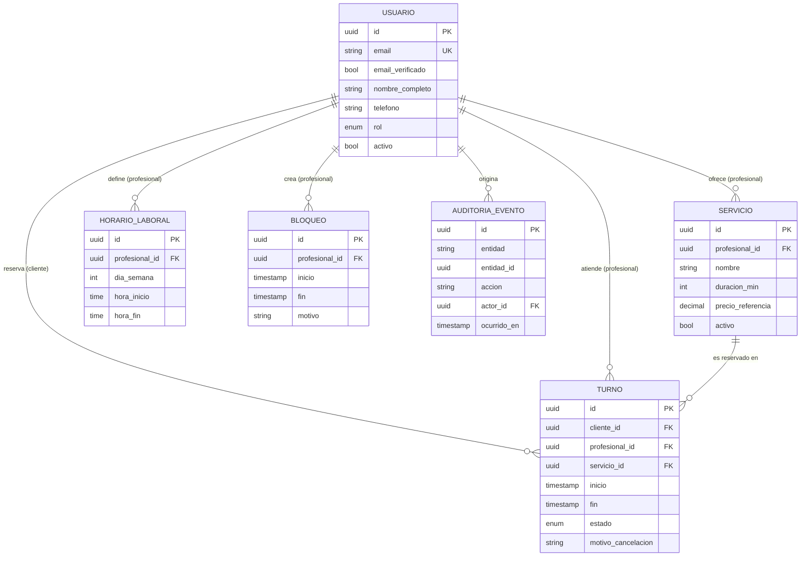

# spec.md — Sistema de Gestión de Turnos y Reservas de Servicios Profesionales

| Campo | Valor |
|---|---|
| Versión | 0.3.1 (MVP · Fase 2) |
| Estado | Borrador para revisión |
| Metodología | Spec-Driven Development (SDD) |
| Fecha | 2026-11-04 |

> Este documento es el **contrato del sistema**. Todo código, test y decisión de diseño debe poder trazarse a una sección de este archivo. Si el código y la spec divergen, se corrige primero la spec y luego el código.

### Historial de versiones

| Versión | Fecha | Cambios |
|---|---|---|
| 0.1.0 | 2026-10-26 | Versión inicial del MVP (prototipo en memoria). |
| 0.2.0 | 2026-11-03 | Fase 2 (arquitectura desacoplada). Se agrega **INV-03** (§3), el **contrato REST** (§11), el mapeo de persistencia (§11.5), los criterios de aceptación 9–11 (§8), los errores `REASON_REQUIRED` y `SERVICE_UNAVAILABLE` (§7, ya usados por el prototipo), las decisiones D-06 a D-08 (§9) y la actualización de D-04. **No se modificó el texto de RN-01 ni RN-02 ni el modelo de datos de §4.** |
| 0.3.0 | 2026-11-03 | La Fase 2 adopta un **modelo simplificado** de una sola tabla `turnos` (`id`, `cliente_nombre`, `cliente_email`, `servicio`, `fecha_hora`, `estado`). Se reescribe §11 completo (contrato, modelo, errores propios `HORARIO_NO_DISPONIBLE`, `CANCELACION_FUERA_DE_VENTANA`, `TURNO_NO_CANCELABLE`, `TURNO_NO_ENCONTRADO`, `FECHA_INVALIDA`, estado `CANCELADO_CLIENTE`, persistencia con índice único parcial). Se actualizan criterios 9–11 (§8), D-04 y D-06 a D-08 (§9) y la trazabilidad (§10). Las reglas de §3 y el modelo de §4 **no cambian**; quedan como objetivo del producto completo y fuera de la Fase 2. |
| 0.3.1 | 2026-11-04 | Tras probar el backend localmente (27 tests + servidor real), se documenta en §11.1 el comportamiento ya implementado: truncado de microsegundos, fecha sin zona = `FECHA_INVALIDA` y rechazo `422` de campos no definidos (`id`, `estado`). Sin cambios de contrato ni de reglas. Se agrega §11.8 (cliente de referencia `reservas.html`). |

Palabras clave normativas: **DEBE** (obligatorio), **NO DEBE** (prohibido), **PUEDE** (opcional), según RFC 2119.

---

## 1. Alcance del MVP

### 1.1 Objetivo
Permitir que clientes reserven turnos con profesionales para servicios con duración definida, y que los profesionales/administradores gestionen su agenda sin conflictos.

### 1.2 Incluido (In scope)

| ID | Capacidad |
|---|---|
| F-01 | Registro e inicio de sesión de usuarios (email + contraseña). |
| F-02 | Catálogo público de servicios (nombre, descripción, duración, precio de referencia, profesional). |
| F-03 | Consulta de disponibilidad por servicio y fecha (slots libres calculados). |
| F-04 | Reserva de turno por parte del Cliente. |
| F-05 | Consulta de "Mis turnos" (próximos e históricos) del Cliente. |
| F-06 | Cancelación de turno propio por el Cliente (sujeta a RN-01). |
| F-07 | Gestión de servicios por el Profesional (alta, edición, baja lógica). |
| F-08 | Definición de horario laboral semanal recurrente del Profesional. |
| F-09 | Bloqueo de rangos horarios (vacaciones, almuerzo, imprevistos). |
| F-10 | Vista de agenda diaria/semanal con todos los turnos del Profesional. |
| F-11 | Cancelación de turno por el Profesional/Administrador (sin restricción de ventana, con motivo). |
| F-12 | Métricas básicas: turnos por período, tasa de cancelación, servicios más reservados, ocupación. |
| F-13 | Notificación por email de confirmación y cancelación. |

### 1.3 Excluido (Out of scope)

- Pagos en línea, señas, reembolsos y facturación.
- Reprogramación directa de turnos (el MVP resuelve con cancelar + reservar nuevo).
- Turnos recurrentes / paquetes de sesiones.
- Lista de espera.
- Múltiples sucursales o recursos físicos (salas, equipos).
- Integración con calendarios externos (Google/Outlook), recordatorios por SMS/WhatsApp.
- Login social / SSO, autenticación multifactor.
- Aplicación móvil nativa (el MVP es web responsive).
- Multi-idioma y multi-moneda (MVP: español, una moneda).
- Reseñas y calificaciones.
- Multi-tenancy (una sola organización por despliegue).

### 1.4 Supuestos

- Una única zona horaria de operación por despliegue (configurable); los instantes se almacenan en UTC.
- Un turno pertenece a **un** profesional y **un** servicio.
- Un profesional atiende un solo turno a la vez (capacidad = 1).
- El cliente final reserva con cuenta registrada (no hay reserva anónima).

---

## 2. Matriz de Roles y Permisos (RBAC)

### 2.1 Roles

| Rol | Descripción |
|---|---|
| `CLIENTE` | Usuario final que reserva servicios. |
| `PROFESIONAL` | Presta servicios; administra su propia agenda y servicios. |
| `ADMIN` | Gestiona toda la operación: todos los profesionales, servicios y usuarios. |
| Anónimo | Visitante sin sesión (solo lectura del catálogo). |

> Para el MVP, `PROFESIONAL` y `ADMIN` comparten el panel de gestión; `ADMIN` amplía el alcance a **todos** los profesionales.

### 2.2 Matriz de permisos

Leyenda: ✅ permitido · ❌ prohibido · 🔒 solo sobre recursos propios

| Recurso / Acción | Anónimo | CLIENTE | PROFESIONAL | ADMIN |
|---|:-:|:-:|:-:|:-:|
| Ver catálogo de servicios | ✅ | ✅ | ✅ | ✅ |
| Ver disponibilidad (slots libres) | ✅ | ✅ | ✅ | ✅ |
| Registrarse / iniciar sesión | ✅ | — | — | — |
| Crear turno | ❌ | ✅ (para sí) | ❌ | ✅ (en nombre de un cliente) |
| Ver turno | ❌ | 🔒 | 🔒 (de su agenda) | ✅ |
| Cancelar turno | ❌ | 🔒 (sujeto a RN-01) | 🔒 (sin ventana mínima) | ✅ (sin ventana mínima) |
| Editar datos de contacto propios | ❌ | 🔒 | 🔒 | ✅ |
| Crear/editar/desactivar servicios | ❌ | ❌ | 🔒 | ✅ |
| Definir horario laboral | ❌ | ❌ | 🔒 | ✅ |
| Bloquear / desbloquear rangos horarios | ❌ | ❌ | 🔒 | ✅ |
| Ver agenda completa | ❌ | ❌ | 🔒 | ✅ |
| Ver métricas | ❌ | ❌ | 🔒 (propias) | ✅ (globales) |
| Gestionar usuarios y roles | ❌ | ❌ | ❌ | ✅ |

### 2.3 Reglas de autorización

- **RBAC-01**: Toda operación DEBE verificar rol **y** propiedad del recurso en el backend; la UI nunca es la barrera de seguridad.
- **RBAC-02**: Un acceso a un recurso ajeno DEBE responder `404` (no `403`) para no revelar su existencia a un `CLIENTE`.
- **RBAC-03**: El rol se asigna únicamente por un `ADMIN`; el auto-registro siempre crea `CLIENTE`.
- **RBAC-04**: Un `CLIENTE` NO DEBE poder ver datos de contacto de otros clientes. El `PROFESIONAL` solo ve los datos de contacto de clientes con turnos en su agenda.

---

## 3. Reglas Invariantes del Negocio

Las siguientes reglas son **no negociables**: se validan en el backend, y la base de datos DEBE reforzarlas con restricciones cuando sea técnicamente posible. Ninguna regla puede ser omitida por la UI ni por un rol (salvo excepción explícita indicada).

**Nomenclatura.** Desde la v0.2.0 las reglas invariantes también se citan con el prefijo `INV-`. Los identificadores `RN-xx` se conservan sin cambios para no romper la trazabilidad (§10, historias de usuario, tareas):

| Alias | Regla | Estado |
|---|---|---|
| INV-01 | RN-01 — Ventana mínima de cancelación (≥ 2 h) | Inmutable |
| INV-02 | RN-02 — Prohibición de doble reserva y solapamiento | Inmutable |
| INV-03 | Persistencia real (ver abajo) | Nueva en v0.2.0 |

### RN-01 — Ventana mínima de cancelación

- Un `CLIENTE` NO DEBE cancelar un turno si faltan **menos de 2 horas** para su `inicio`.
- Valor configurable (`CANCELLATION_WINDOW_HOURS`, default `2`); el cálculo usa `inicio - ahora(UTC)`.
- Un turno ya iniciado, finalizado o cancelado NO DEBE ser cancelable.
- **Excepción**: `PROFESIONAL`/`ADMIN` PUEDEN cancelar fuera de ventana, con motivo obligatorio, y el cliente DEBE ser notificado.
- Respuesta ante violación: error `CANCELLATION_WINDOW_EXPIRED` (HTTP 409).

### RN-02 — Prohibición de doble reserva y solapamiento

- Para un mismo profesional, dos turnos en estado activo (`CONFIRMADO`) NO DEBEN solaparse en el tiempo.
- Se define el solapamiento sobre intervalos semiabiertos `[inicio, fin)`: dos turnos A y B se solapan si `A.inicio < B.fin` **y** `B.inicio < A.fin`. Turnos contiguos (`A.fin == B.inicio`) son válidos.
- Un turno NO DEBE solaparse con un bloqueo horario (RN-05) ni quedar fuera del horario laboral del profesional.
- Un mismo cliente NO DEBE tener dos turnos activos solapados (aunque sean con distintos profesionales).
- **Garantía ante concurrencia**: la verificación DEBE ser atómica. Se exige restricción a nivel de base de datos (p. ej. `EXCLUDE USING gist` sobre rango temporal por profesional en PostgreSQL, o transacción con bloqueo + índice único equivalente). Una validación solo en la aplicación NO es suficiente.
- Los turnos `CANCELADO` NO participan del control de solapamiento (el slot se libera).
- Respuesta ante violación: error `SLOT_UNAVAILABLE` (HTTP 409).

### RN-03 — Validación obligatoria de datos de contacto

- Para crear un turno, el `CLIENTE` DEBE tener un perfil con: **nombre completo** (2–100 caracteres), **email válido** (RFC 5322 simplificado, único por usuario) y **teléfono** válido en formato E.164 o equivalente local normalizado.
- El email DEBE estar **verificado** (enlace de confirmación) antes de la primera reserva.
- La reserva NO DEBE persistirse si algún dato de contacto falta o es inválido (error `INVALID_CONTACT`, HTTP 422).
- Los datos se normalizan (trim, minúsculas en email, teléfono a E.164) antes de validar y guardar.

### RN-04 — Integridad temporal del turno

- `inicio` DEBE ser estrictamente futuro respecto a `ahora` al momento de crear el turno, con una **antelación mínima** configurable (default: 1 hora).
- `fin = inicio + duración del servicio`; el cliente NO DEBE enviar `fin` (se calcula en servidor).
- El `inicio` DEBE estar alineado a la grilla de slots del profesional (default: 15 min).
- Existe un **horizonte máximo de reserva** (default: 60 días).
- Todos los instantes se almacenan en UTC y se muestran en la zona horaria de operación.

### RN-05 — Bloqueos horarios

- Un bloqueo es un rango `[inicio, fin)` del profesional en el que no se pueden crear turnos.
- Crear un bloqueo sobre un rango con turnos activos DEBE ser rechazado con listado de conflictos, **salvo** que el profesional confirme cancelarlos (lo cual aplica la excepción de RN-01 y notifica a los clientes).

### RN-06 — Ciclo de vida del turno

Estados: `CONFIRMADO` → `CANCELADO` | `COMPLETADO` | `AUSENTE`.

| Transición | Quién | Condición |
|---|---|---|
| (nuevo) → `CONFIRMADO` | Cliente / Admin | Cumple RN-02, RN-03, RN-04 |
| `CONFIRMADO` → `CANCELADO` | Cliente | Cumple RN-01 |
| `CONFIRMADO` → `CANCELADO` | Profesional / Admin | Motivo obligatorio |
| `CONFIRMADO` → `COMPLETADO` | Profesional / Admin | `ahora ≥ inicio` |
| `CONFIRMADO` → `AUSENTE` | Profesional / Admin | `ahora ≥ fin` |

- Los estados `CANCELADO`, `COMPLETADO` y `AUSENTE` son **terminales**; ninguna transición sale de ellos.
- Un turno NO DEBE eliminarse físicamente; el historial es inmutable (solo cambia de estado).

### RN-07 — Integridad de catálogo

- Un servicio con turnos futuros activos NO DEBE eliminarse; solo desactivarse (baja lógica), lo cual impide nuevas reservas sin afectar las existentes.
- La duración de un servicio DEBE ser múltiplo de la grilla de slots y estar entre 15 min y 8 h.
- Modificar la duración de un servicio NO altera turnos ya confirmados.

### RN-08 — Trazabilidad

- Toda creación, cancelación y cambio de estado DEBE registrar: actor, rol, instante UTC y motivo (si aplica) en un log de auditoría inmutable.

### INV-03 — Persistencia real

- Los turnos DEBEN persistir en una base de datos relacional, no en la memoria del proceso del cliente (navegador) ni del servidor.
- **Atomicidad**: crear o cancelar un turno es una única transacción. En el modelo completo se confirman juntos el cambio sobre `Turno` y su registro de auditoría (RN-08); en la Fase 2 (sin auditoría, §11) es una única sentencia atómica. Una operación rechazada NO DEBE dejar rastro parcial en `Turno`.
- **Durabilidad**: un turno confirmado DEBE sobrevivir al reinicio del backend y al de la base de datos. Tras el reinicio, `GET /api/turnos` DEBE devolver exactamente el mismo conjunto de turnos, con los mismos estados.
- **Fuente única de verdad**: el estado de los turnos se lee y escribe únicamente a través de la API (§11). El frontend NO DEBE conservar una copia autoritativa.
- INV-01 e INV-02 DEBEN seguir cumpliéndose sobre los datos persistidos; el motor elegido DEBE reforzar INV-02 a nivel de base de datos (ver RN-02 y §11.7).
- No se admite un "reinicio de datos" que borre turnos desde la API; el historial es inmutable (RN-06).

---

## 4. Modelo de Datos Conceptual

### 4.1 Entidades principales

#### Usuario
| Atributo | Tipo | Restricciones |
|---|---|---|
| `id` | UUID | PK |
| `email` | texto | Único, obligatorio, normalizado |
| `email_verificado` | booleano | Default `false` |
| `password_hash` | texto | Obligatorio (nunca en claro) |
| `nombre_completo` | texto | Obligatorio, 2–100 |
| `telefono` | texto | Obligatorio, E.164 |
| `rol` | enum | `CLIENTE` \| `PROFESIONAL` \| `ADMIN` |
| `activo` | booleano | Default `true` |
| `creado_en` | timestamp UTC | |

#### Servicio
| Atributo | Tipo | Restricciones |
|---|---|---|
| `id` | UUID | PK |
| `profesional_id` | UUID | FK → Usuario (rol `PROFESIONAL`) |
| `nombre` | texto | Obligatorio |
| `descripcion` | texto | Opcional |
| `duracion_min` | entero | 15–480, múltiplo de la grilla |
| `precio_referencia` | decimal | ≥ 0, informativo |
| `activo` | booleano | Baja lógica (RN-07) |

#### Turno
| Atributo | Tipo | Restricciones |
|---|---|---|
| `id` | UUID | PK |
| `cliente_id` | UUID | FK → Usuario (rol `CLIENTE`) |
| `profesional_id` | UUID | FK → Usuario (rol `PROFESIONAL`) |
| `servicio_id` | UUID | FK → Servicio |
| `inicio` | timestamp UTC | Futuro al crear (RN-04) |
| `fin` | timestamp UTC | Calculado: `inicio + duración` |
| `estado` | enum | Ver RN-06 |
| `motivo_cancelacion` | texto | Obligatorio si lo cancela Profesional/Admin |
| `cancelado_por_id` | UUID | FK → Usuario, nullable |
| `creado_en` / `actualizado_en` | timestamp UTC | |

*Restricción clave*: exclusión de rangos `[inicio, fin)` por `profesional_id` cuando `estado = CONFIRMADO` (RN-02).

#### Entidades de soporte

| Entidad | Atributos clave | Propósito |
|---|---|---|
| **HorarioLaboral** | `id`, `profesional_id`, `dia_semana` (0–6), `hora_inicio`, `hora_fin` | Disponibilidad semanal recurrente (F-08). |
| **Bloqueo** | `id`, `profesional_id`, `inicio`, `fin`, `motivo` | Rangos no reservables (F-09, RN-05). |
| **AuditoriaEvento** | `id`, `entidad`, `entidad_id`, `accion`, `actor_id`, `rol`, `ocurrido_en`, `detalle` | Trazabilidad inmutable (RN-08). |

### 4.2 Relaciones y cardinalidad

```
Usuario (PROFESIONAL) 1 ──── N Servicio
Usuario (PROFESIONAL) 1 ──── N HorarioLaboral
Usuario (PROFESIONAL) 1 ──── N Bloqueo
Usuario (PROFESIONAL) 1 ──── N Turno      (como profesional atendiendo)
Usuario (CLIENTE)     1 ──── N Turno      (como cliente reservando)
Servicio              1 ──── N Turno
Usuario               1 ──── N AuditoriaEvento (actor)
```



### 4.3 Invariantes de integridad referencial

- `Turno.profesional_id` DEBE coincidir con `Servicio.profesional_id` del `servicio_id` asociado.
- `Turno.cliente_id` y `Turno.profesional_id` DEBEN ser usuarios distintos.
- Ninguna FK usa borrado en cascada sobre `Turno`; el historial se preserva (RN-06, RN-07).

---

## 5. Métricas del MVP (F-12)

| Métrica | Definición |
|---|---|
| Turnos por período | Conteo de turnos `CONFIRMADO`/`COMPLETADO` agrupados por día/semana/mes. |
| Tasa de cancelación | `CANCELADO / total creados` en el período, con desglose por quién canceló. |
| Tasa de ausentismo | `AUSENTE / (COMPLETADO + AUSENTE)`. |
| Ocupación | Minutos reservados / minutos disponibles (horario laboral − bloqueos). |
| Top servicios | Ranking de servicios por cantidad de turnos. |

Alcance: el `PROFESIONAL` ve solo las suyas; el `ADMIN` ve las globales y por profesional.

---

## 6. Requisitos No Funcionales (mínimos del MVP)

- **Seguridad**: contraseñas con hash adaptativo (argon2/bcrypt), HTTPS obligatorio, sesiones con expiración, protección CSRF/XSS, rate limiting en login y reserva.
- **Consistencia**: la creación de turno es transaccional y atómica (RN-02).
- **Rendimiento**: consulta de disponibilidad < 500 ms p95 con hasta 50 profesionales.
- **Privacidad**: datos de contacto accesibles solo según RBAC-04; cumplimiento de la normativa local de protección de datos personales.
- **Disponibilidad**: objetivo 99,5 % mensual (sin HA en MVP).
- **Accesibilidad**: WCAG 2.1 AA en flujos de reserva.

---

## 7. Catálogo de Errores de Dominio

| Código | HTTP | Origen |
|---|---|---|
| `SLOT_UNAVAILABLE` | 409 | RN-02, RN-05 |
| `CANCELLATION_WINDOW_EXPIRED` | 409 | RN-01 |
| `INVALID_CONTACT` | 422 | RN-03 |
| `EMAIL_NOT_VERIFIED` | 403 | RN-03 |
| `INVALID_TIME_RANGE` | 422 | RN-04 |
| `INVALID_STATE_TRANSITION` | 409 | RN-06 |
| `SERVICE_HAS_ACTIVE_BOOKINGS` | 409 | RN-07 |
| `FORBIDDEN` / `NOT_FOUND` | 403 / 404 | RBAC-01, RBAC-02 |
| `REASON_REQUIRED` | 422 | RN-01 (motivo obligatorio para Profesional/Admin) |
| `SERVICE_UNAVAILABLE` | 409 | RN-07 (servicio inactivo, sin nuevas reservas) |

---

## 8. Criterios de Aceptación (muestra Given/When/Then)

1. **Doble reserva**: *Dado* un turno `CONFIRMADO` de 10:00–10:30 con el profesional P, *cuando* otro cliente reserva 10:15–10:45 con P, *entonces* el sistema responde `SLOT_UNAVAILABLE` y no persiste nada.
2. **Concurrencia**: *Dado* dos solicitudes simultáneas por el mismo slot, *entonces* exactamente una se confirma y la otra recibe `SLOT_UNAVAILABLE`.
3. **Contigüidad**: *Dado* un turno 10:00–10:30, *cuando* se reserva 10:30–11:00, *entonces* se confirma.
4. **Cancelación en ventana**: *Dado* un turno que inicia en 3 h, *cuando* el cliente cancela, *entonces* pasa a `CANCELADO` y el slot queda libre.
5. **Cancelación fuera de ventana**: *Dado* un turno que inicia en 1 h 59 min, *cuando* el cliente cancela, *entonces* `CANCELLATION_WINDOW_EXPIRED`.
6. **Contacto inválido**: *Dado* un cliente sin teléfono válido, *cuando* intenta reservar, *entonces* `INVALID_CONTACT`.
7. **Aislamiento**: *Dado* el turno T del cliente A, *cuando* el cliente B consulta T, *entonces* recibe `404`.
8. **Bloqueo con conflicto**: *Dado* un turno confirmado dentro de un rango, *cuando* el profesional intenta bloquearlo sin confirmar, *entonces* el sistema lista los conflictos y no crea el bloqueo.
9. **Persistencia tras reinicio (INV-03)**: *Dado* un turno creado con `POST /api/turnos` (respuesta 201), *cuando* se reinicia el backend, *entonces* `GET /api/turnos` lo devuelve con el mismo `id`, `fecha_hora` y `estado`.
10. **Atomicidad (INV-03)**: *Dado* un `POST /api/turnos` rechazado con `HORARIO_NO_DISPONIBLE`, *entonces* `GET /api/turnos` no contiene ningún turno nuevo.
11. **Cancelación persistida (INV-01 + INV-03)**: *Dado* un turno que inicia en 3 h, *cuando* se invoca `POST /api/turnos/{id}/cancelar` y luego se reinicia el backend, *entonces* el turno sigue en `CANCELADO_CLIENTE` y su slot sigue libre; y *dado* uno que inicia en 1 h 59 min, la misma llamada responde `CANCELACION_FUERA_DE_VENTANA` (409) y el turno sigue `CONFIRMADO`.

> En la API de la Fase 2 los criterios 1, 2 y 5 usan los códigos de §11.6 (`HORARIO_NO_DISPONIBLE` y `CANCELACION_FUERA_DE_VENTANA`). Los criterios 3 y 4 se aplican con el slot atómico de §11.2: reservar dos `fecha_hora` distintas es válido. Los criterios 6, 7 y 8 pertenecen al modelo completo de §4 y quedan fuera de la Fase 2.

---

## 9. Decisiones Abiertas (a resolver antes de implementar)

| # | Pregunta | Propuesta por defecto |
|---|---|---|
| D-01 | ¿Un cliente puede tener límite de turnos activos simultáneos? | Sin límite en MVP |
| D-02 | ¿Los Profesionales pueden ser dados de alta por auto-registro? | No, solo vía `ADMIN` |
| D-03 | ¿Política de cancelaciones reiteradas / penalización? | Fuera del MVP |
| D-04 | Stack tecnológico y motor de BD (requiere soporte de exclusión de rangos) | **Resuelta para la Fase 2**: Python + FastAPI y SQLite (`turnos.db`). SQLite no tiene `EXCLUDE USING gist`; RN-02 admite como alternativa "transacción con bloqueo + índice único equivalente", que en la Fase 2 se implementa con un **índice único parcial** sobre `fecha_hora` donde `estado = 'CONFIRMADO'` (§11.7). PostgreSQL queda como destino de producción. |
| D-05 | ¿Confirmación automática o aprobación manual del profesional? | Automática |
| D-06 | ¿Cómo se identifica al actor en la Fase 2, si F-01 (login) no está implementada? | **Resuelta para la Fase 2**: no hay actores ni autenticación. El cliente se describe con `cliente_nombre` y `cliente_email` en el propio turno. RBAC-01/02/04 quedan sin garantía hasta implementar F-01. `GET /api/turnos` devuelve todos los turnos. |
| D-07 | El contrato de la Fase 2 solo cubre turnos. El frontend también necesita catálogo (F-02) y disponibilidad (F-03). ¿Cómo los obtiene? | **Resuelta para la Fase 2**: no hay endpoints de catálogo ni de disponibilidad. `servicio` es texto libre en el turno y la disponibilidad de un horario se conoce al reservar (`HORARIO_NO_DISPONIBLE`) o consultando `GET /api/turnos`. F-02 y F-03 quedan para una fase posterior. |
| D-08 | ¿Cómo se cargan los `Usuario`, `Servicio`, `HorarioLaboral` y `Bloqueo` en `turnos.db`, ya que ningún endpoint de §11 los crea? | **No aplica en la Fase 2**: con la tabla única `turnos` no hay entidades que precargar; el backend crea la tabla al iniciar. Un seed de las 6 entidades de §4.1 se retoma si se vuelve al modelo completo. |

---

## 10. Trazabilidad (Spec → Código → Test)

| Spec | Código (a completar) | Test (a completar) |
|---|---|---|
| RN-01 | — | Criterios 4, 5 |
| RN-02 | — | Criterios 1, 2, 3 |
| RN-03 | — | Criterio 6 |
| RBAC-02 | — | Criterio 7 |
| RN-05 | — | Criterio 8 |
| INV-03 | — | Criterios 9, 10, 11 |
| §11 (contrato REST) | `backend/main.py` | Criterios 1, 2, 5, 9–11 y los de `backend/test_main.py` |

---

## 11. Contrato de API REST (Fase 2)

Gobierna la comunicación entre Frontend y Backend. El Backend DEBE implementar exactamente este contrato; el Frontend NO DEBE depender de nada que no figure aquí.

> **Alcance de la Fase 2 (v0.3.0).** La Fase 2 trabaja con un **modelo simplificado de un único recurso**: una tabla `turnos`, sin entidades `Usuario`, `Servicio`, `HorarioLaboral` ni `Bloqueo`. El modelo completo de §4 sigue siendo el objetivo del producto, pero **no** se persiste en la Fase 2. Donde §3 menciona al profesional, a bloqueos o al horario laboral, esas verificaciones quedan fuera de la Fase 2.

### 11.1 Convenciones

- Base: `http://localhost:8000`. Prefijo `/api`. Formato `application/json`, UTF-8.
- Instantes (`fecha_hora`) en ISO 8601 UTC, p. ej. `2026-11-04T13:00:00Z` (RN-04). Se aceptan también offsets (`-03:00`) y se normalizan a UTC. Una fecha sin zona horaria es `FECHA_INVALIDA`.
- Los instantes se truncan al segundo (se descartan los microsegundos) antes de comparar y guardar: `10:00:00.789` y `10:00:00` son el mismo slot (INV-02). Una fecha solo con día (`2030-01-01`) no tiene zona horaria y es `FECHA_INVALIDA`.
- El servidor calcula `id` (UUID v4) y `estado`. El cliente NO DEBE enviarlos; si el cuerpo de `POST /api/turnos` incluye cualquier campo no definido en §11.4 (p. ej. `id` o `estado`), se rechaza con `422` (error de forma de Pydantic).
- El backend DEBE habilitar CORS con `allow_origins=["*"]`.
- Error: cuerpo `{ "detail": { "code": "<§11.6>", "message": "<texto>" } }` con el HTTP de §11.6. Los errores de validación de forma (campos ausentes o con tipo incorrecto) los produce Pydantic con HTTP `422` y el formato estándar de FastAPI (`detail` como lista).
- Sin autenticación (D-06): la API no identifica al actor.

### 11.2 Modelo `Turno` (tabla `turnos`)

| Campo | Tipo | Restricciones |
|---|---|---|
| `id` | UUID v4 (`TEXT`) | PK. Generado por el servidor. |
| `cliente_nombre` | texto | 2–100 caracteres tras `trim`. |
| `cliente_email` | texto | Email válido (RFC 5322 simplificado), en minúsculas. |
| `servicio` | texto | 1–100 caracteres tras `trim`. Texto libre (D-07). |
| `fecha_hora` | timestamp UTC (`TEXT` `YYYY-MM-DDTHH:MM:SSZ`) | Instante de **inicio** del turno. Estrictamente futuro al crear. |
| `estado` | enum | `CONFIRMADO` \| `CANCELADO_CLIENTE`. |

El turno no tiene duración: ocupa el instante `fecha_hora` como un slot atómico. Dos turnos `CONFIRMADO` con el mismo `fecha_hora` colisionan (INV-02).

### 11.3 `GET /api/turnos` — listar turnos

| Aspecto | Valor |
|---|---|
| Request | Sin cuerpo ni parámetros. |
| Éxito | `200` con un arreglo de objetos `Turno`, ordenado por `fecha_hora` ascendente. Incluye todos los estados (el historial es inmutable, RN-06). Arreglo vacío si no hay turnos. |
| Idempotencia | Seguro e idempotente; no modifica estado. |

### 11.4 `POST /api/turnos` — crear reserva

| Aspecto | Valor |
|---|---|
| Request | `{ "cliente_nombre": texto, "cliente_email": texto, "servicio": texto, "fecha_hora": ISO-8601 }` |
| Éxito | `201` con el objeto `Turno` creado, `estado = "CONFIRMADO"`. Cabecera `Location: /api/turnos/{id}`. |
| Reglas | **INV-02**: si ya existe un turno `CONFIRMADO` con el mismo `fecha_hora`, no se inserta nada. RN-03 (nombre y email), RN-04 (futuro, UTC). INV-03. |
| Atomicidad | La unicidad de `fecha_hora` entre turnos `CONFIRMADO` la garantiza la base con un índice único parcial; una validación solo en la aplicación no es suficiente (RN-02). |

Errores:

| Código | HTTP | Condición |
|---|---|---|
| `HORARIO_NO_DISPONIBLE` | 409 | Ya existe un turno `CONFIRMADO` en ese `fecha_hora` (INV-02). |
| `FECHA_INVALIDA` | 422 | `fecha_hora` no es ISO 8601 válido o no es estrictamente futura (RN-04). |
| (Pydantic) | 422 | Campos ausentes, tipos incorrectos, nombre/email/servicio fuera de rango o con formato inválido. |

### 11.5 `POST /api/turnos/{id}/cancelar` — cancelar reserva

| Aspecto | Valor |
|---|---|
| Path | `id`: UUID del `Turno`. |
| Request | Sin cuerpo. |
| Éxito | `200` con el `Turno` actualizado: `estado = "CANCELADO_CLIENTE"`. El turno NO se elimina (RN-06). |
| Reglas | **INV-01**: se calcula `fecha_hora − ahora` (UTC, reloj del servidor). Si faltan **menos de 2 horas**, se rechaza. Con **exactamente 2 horas o más** se cancela. INV-03. |

Errores:

| Código | HTTP | Condición |
|---|---|---|
| `CANCELACION_FUERA_DE_VENTANA` | 409 | Faltan menos de 2 h para `fecha_hora` (INV-01), incluido un turno cuyo horario ya pasó. |
| `TURNO_NO_CANCELABLE` | 409 | El turno ya no está `CONFIRMADO` (RN-06). |
| `TURNO_NO_ENCONTRADO` | 404 | No existe un turno con ese `id`. |

### 11.6 Catálogo de errores de la API de la Fase 2

Estos códigos reemplazan, **solo en la API de la Fase 2**, a los equivalentes de §7:

| Código Fase 2 | HTTP | Equivalente en §7 | Origen |
|---|---|---|---|
| `HORARIO_NO_DISPONIBLE` | 409 | `SLOT_UNAVAILABLE` | INV-02 |
| `CANCELACION_FUERA_DE_VENTANA` | 409 | `CANCELLATION_WINDOW_EXPIRED` | INV-01 |
| `TURNO_NO_CANCELABLE` | 409 | `INVALID_STATE_TRANSITION` | RN-06 |
| `TURNO_NO_ENCONTRADO` | 404 | `NOT_FOUND` | — |
| `FECHA_INVALIDA` | 422 | `INVALID_TIME_RANGE` | RN-04 |

El estado `CANCELADO_CLIENTE` es el valor de §4.1 `CANCELADO` cuando quien cancela es el cliente (la Fase 2 no tiene otros actores).

### 11.7 Mapeo de persistencia (SQLite · `turnos.db`)

Una sola tabla, creada automáticamente al iniciar el servidor:

```sql
CREATE TABLE IF NOT EXISTS turnos (
    id             TEXT PRIMARY KEY,
    cliente_nombre TEXT NOT NULL,
    cliente_email  TEXT NOT NULL,
    servicio       TEXT NOT NULL,
    fecha_hora     TEXT NOT NULL,
    estado         TEXT NOT NULL CHECK (estado IN ('CONFIRMADO', 'CANCELADO_CLIENTE'))
);
CREATE UNIQUE INDEX IF NOT EXISTS ux_turnos_slot_confirmado
    ON turnos (fecha_hora) WHERE estado = 'CONFIRMADO';
```

- Correspondencia de tipos: UUID → `TEXT`; timestamp UTC → `TEXT` ISO 8601 de formato fijo `YYYY-MM-DDTHH:MM:SSZ` (comparable cronológicamente como texto); enum → `TEXT` con `CHECK`.
- El índice único parcial refuerza INV-02 en la base: un segundo `CONFIRMADO` en el mismo `fecha_hora` falla aunque dos solicitudes lleguen a la vez. Un turno `CANCELADO_CLIENTE` libera el slot (RN-02).
- Sin borrado físico desde la API (RN-06).

### 11.8 Cliente de referencia (`reservas.html`)

Página estática sin dependencias que consume únicamente los tres endpoints de §11 (reservar, listar, cancelar). Sirve para probar el contrato en local: se abre directamente desde el disco (`file://`, permitido por el CORS de §11.1) con el backend en `http://localhost:8000`; otra base se indica con `?api=<url>`.

- Convierte la fecha local del formulario a ISO 8601 UTC con zona (`toISOString()`), como exige §11.1.
- Muestra `detail.code` y `detail.message` de los errores de dominio y los errores de forma (`detail` como lista).
- No guarda turnos localmente: tras cada operación vuelve a leer `GET /api/turnos` (INV-03, fuente única de verdad).
- No reemplaza a `index.html`, que sigue siendo el prototipo en memoria del modelo completo (tareas 12.1 a 12.3 siguen pendientes).
